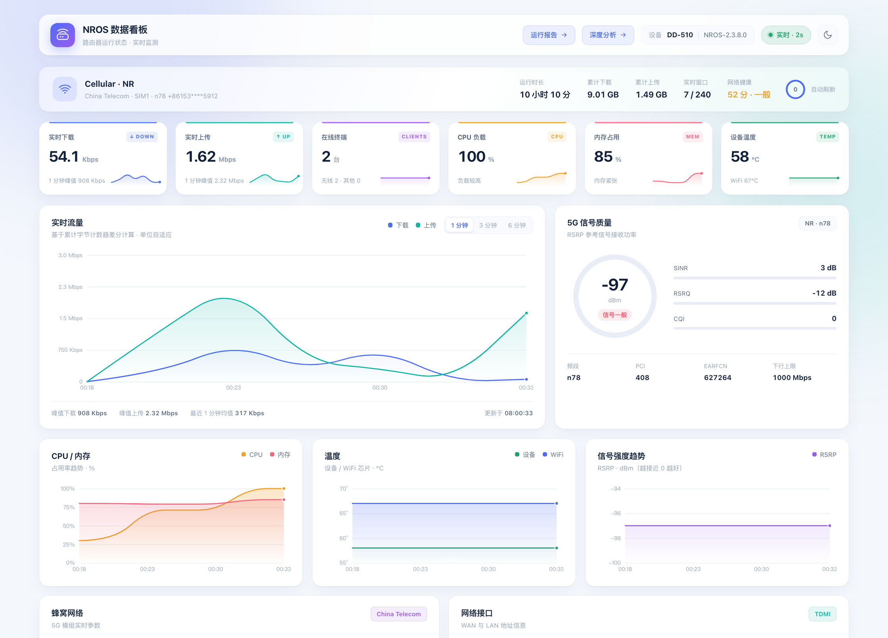

# Router Dashboard

**5G CPE / OpenWrt(LuCI) 路由器实时数据看板** —— 零第三方依赖的 Node.js 代理 + 纯原生 Canvas/SVG 前端，无需安装任何 npm 包，Node 18+ 直接运行。



> 本项目源于对一台 5G CPE（nradio 定制 OpenWrt 固件）的接口逆向：抓包分析 LuCI 登录流程，挖掘出运行时状态、流量计数、5G 模组、SIM 套餐、短信、系统日志等接口，在此基础上构建了实时看板、深度分析与运行报告三个页面。

## 特性

**实时看板（`/`）**
- 实时上下行速率（累计字节计数器差分计算，防计数器复位尖峰）
- KPI 迷你趋势（下载/上传/终端/CPU/内存/温度）、5G 信号仪表盘（RSRP/SINR/RSRQ/CQI）
- 终端列表与协商速率排行、WAN/LAN、WiFi 概览、流量用量环图、短信收件箱
- 深浅双主题、悬停查看数值、1/3/6 分钟范围切换

**深度分析（`/analysis`）**
- 会话统计（峰值 / 均值 / P95 / 空闲占比）、多维稳定性表（min·avg·max·P95·σ）
- 网络健康评分（信号 + 信噪比 + CPU + 内存 + 温度加权）
- 分时流量柱状图、速率分布直方图、终端画像、可筛选事件时间线
- 5G 模组详情、双 SIM 卡用量、短信容量、CSV 导出、1h/6h/24h 时间窗

**运行报告（`/report`）**
- 文档式排版的一键汇总报告，支持时间窗切换、30s 自动刷新
- 「打印 / 导出 PDF」按钮（print 样式优化），自动生成报告编号

## 快速开始

```bash
# 1. 复制配置文件并填入你的路由器信息
cp config.env.example config.env
vi config.env   # 填 ROUTER_HOST 与 ROUTER_PASSWORD

# 2. 启动（无需 npm install）
node server.js   # 或 npm start

# 3. 打开浏览器
open http://127.0.0.1:8787/
```

macOS 可直接双击 `start.command`。

### 配置项

| 变量 | 必填 | 默认 | 说明 |
|---|---|---|---|
| `ROUTER_HOST` | ✅ | — | 路由器管理地址（如 `192.168.1.1`） |
| `ROUTER_PASSWORD` | ✅ | — | LuCI 管理密码 |
| `ROUTER_USER` | | `root` | 登录用户名 |
| `PORT` | | `8787` | 服务端口 |
| `BIND` | | `127.0.0.1` | 监听地址（改 `0.0.0.0` 前请评估风险） |
| `POLL_MS` | | `2000` | 实时轮询周期（毫秒，不建议 < 1000） |

环境变量优先于 `config.env` 文件。

## 工作原理

```
浏览器 ──同源 JSON──▶ 本地代理(Node) ──模拟 LuCI 登录──▶ 路由器
                      │  · sysauth 会话保活，失效自动重登
                      │  · 2s 轮询运行时 + 流量计数器（差分算速率）
                      │  · 30s/60s 低频轮询模组 / SIM / 短信 / 系统日志
                      │  · 采样点落盘 data/samples.jsonl（保留 24h）
                      └─ 路由器密码与会话永不下发浏览器
```

### 主要 API

| 接口 | 说明 |
|---|---|
| `GET /api/snapshot` | 当前状态快照 + 内存中的趋势采样点 |
| `GET /api/analysis?window=分钟` | 衍生分析（0 = 全部）：统计 / 稳定性 / 画像 / 事件 |
| `GET /api/sms` | 短信列表与容量（服务端 30s 缓存） |
| `GET /api/export.csv?window=分钟` | 采样数据 CSV 导出 |
| `GET /api/refresh-logs` | 手动触发系统日志刷新 |
| `GET /api/health` | 服务健康状态 |

### 上游接口（nradio 定制 LuCI）

| 接口 | 周期 | 用途 |
|---|---|---|
| `POST /cgi-bin/luci`（表单登录） | 失效时 | 获取 `sysauth` 会话 |
| `POST nradio/status/runtime/wan,cpe_4` | 2s | 全量运行状态 |
| `GET nradio/status/speed/cpe` | 2s | 累计上下行字节（差分算速率） |
| `GET nradio/cellular/cpestatus/cellinfo` | 30s | 5G 模组详情 |
| `POST nradio/cellular/cpedata/refresh` | 30s | SIM 卡用量 |
| `GET nradio/cellular/sms/list` | 30s | 短信列表 |
| `GET nradioadv/system/logread` | 60s | 系统日志（结构化解析为事件） |

## 兼容性

- 针对 **nradio 定制固件**（如 DD-510 等 5G CPE）开发并实测，标准 OpenWrt/LuCI 设备的接口路径不同，需要按本文档的方法抓包后修改 `server.js` 顶部的路径常量与 `buildSnapshot()` 解析逻辑。
- 理论上所有「LuCI 表单登录 + 定制 nradio 页面」的 CPE 都能直接使用，欢迎提交适配反馈。

## 安全与隐私

- 服务默认只监听 `127.0.0.1`，局域网内其它设备无法访问
- 路由器密码仅存在于本地 `config.env`（已加入 `.gitignore`）或环境变量中，不会出现在代码、日志和浏览器
- 上游数据中的 IMEI / ICCID / 手机号 / 小区标识在接口层统一脱敏后才提供给前端
- `data/` 采样记录含本机网络信息，同样已被 `.gitignore` 忽略

## 免责声明

本项目仅用于学习与自己家路由器的数据可视化，请勿用于未授权的设备。使用本项目产生的一切后果由使用者自行承担。

## License

[MIT](LICENSE)
